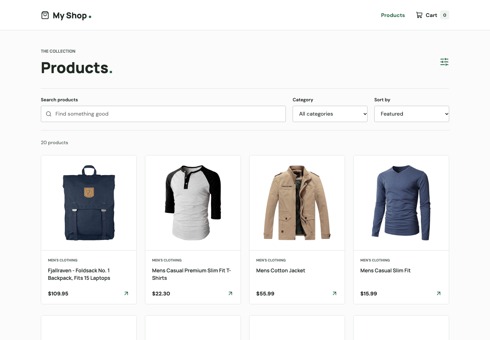
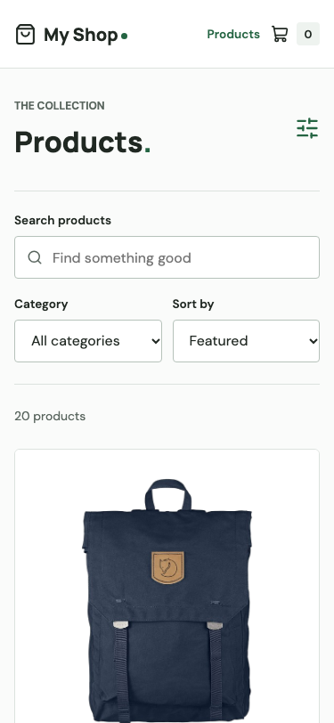

# My Shop

My Shop is a practice online store. You can browse products, search for something you like, add items to a cart, and try a sample checkout.

**This is a demo, not a real shop. You will not be charged, and nothing will be ordered or delivered.**

## What You Can Do

- Browse products with photos, descriptions, and prices in US dollars.
- Search by product name, choose a category, or change the sort order.
- Select a product to see more details.
- Add items to your cart, change quantities, and remove items.
- Return later in the same browser and find your saved cart, as long as browser storage is available and has not been cleared.
- Try the sample checkout and see a confirmation screen.
- Use the shop on a computer, tablet, or phone.

## Take a Look

On a computer:



On a phone:



## Try the Shop

The project is set up to be published at this address:

```text
https://youssefbouhlal.github.io/react-redux-store/
```

**This is the expected address, not a confirmed live website.** If it does not open, the site may not have been published yet. The setup steps below let you run it on your own computer.

Once the shop is open:

1. Browse the catalog or use the search and category filters.
2. Select a product to read about it, then add it to your cart.
3. Open the cart to review your items and adjust quantities.
4. Continue to checkout to try the sample form. Use made-up details, not real personal information.
5. Submit the form to see a demo confirmation. No real order is placed.

## Run It on Your Computer

This section is for someone setting up the project. You only need to do this if you are not using a published version of the shop.

### 1. Get Ready

You need the project files and Node.js, a tool that runs the app's development tools. Node.js includes `npm`, which is used in the commands below.

Supported versions are Node.js 22.12 or later within version 22, version 24, or version 26 and above. The project is configured to use version 22 by default.

Open the `react-redux-store` folder in VS Code, then choose **Terminal > New Terminal**. The terminal is where you type the commands below. Make sure it is open in that folder, not the surrounding WordPress folder.

You do not need WordPress, a database, an account, or an API key to run this app. An internet connection is needed to download the required packages and load product information and photos.

### 2. Install What the App Needs

Run this command and wait for it to finish:

```sh
npm ci
```

This downloads the packages the app uses. Run it the first time you set up the project, or after its package requirements change.

### 3. Start the Shop

```sh
npm run dev
```

Keep the terminal open while you use the shop. Open the local web address shown in the terminal, including `/react-redux-store/`. It will usually look like this:

```text
http://127.0.0.1:5173/react-redux-store/#/
```

This address opens the shop running on your computer. The port number, such as `5173`, may be different, so use the address your terminal shows.

To stop the shop, select the terminal and press **Control + C**. To start it again later, run `npm run dev` from the same folder.

### Having Trouble?

| What you see                                              | What to try                                                                                                                                            |
| --------------------------------------------------------- | ------------------------------------------------------------------------------------------------------------------------------------------------------ |
| `npm` is not found                                        | Install a supported version of Node.js, then close and reopen the terminal.                                                                            |
| An error says the project or package file cannot be found | Make sure the terminal is open in the `react-redux-store` folder.                                                                                      |
| The page does not open                                    | Check that `npm run dev` is still running and use the exact address printed in the terminal.                                                           |
| Products or photos do not load                            | Check your internet connection. Product information comes from an external service that may be temporarily unavailable. Use the retry option if shown. |
| Opening the HTML file does not work                       | Start the app with `npm run dev` instead of opening the HTML file directly.                                                                            |

## Important Things to Know

- **No real purchases:** the app does not take payments, reserve stock, or arrange delivery. Prices and totals are for demonstration only; taxes and shipping are not validated.
- **Your cart can be saved:** the app stores cart items in your browser, when browser storage is available. Clearing browser data removes the saved cart.
- **Checkout details are temporary:** the app does not send or save the personal details entered into the checkout form. The confirmation disappears when you reload the page.
- **Products come from another service:** product information and images are supplied by Fake Store API. If that service is unavailable, the catalog may not load. The browser contacts that service to load products and images.
- **No added analytics:** fonts are included with the app, and no analytics service has been added.
- **Accessibility still needs human review:** the app includes keyboard navigation and automated accessibility checks, but these do not replace testing with assistive technology.

## Developer Reference

The details below are for people maintaining or publishing the project. You do not need them just to try the shop.

### Tools and Structure

The app uses React, TypeScript, Redux Toolkit, RTK Query, and Vite. It runs independently of WordPress.

- [src/services/productsApi.ts](src/services/productsApi.ts) loads and caches product data.
- [src/types/product.ts](src/types/product.ts) checks the format of incoming product data.
- [src/features/cart/](src/features/cart/) manages the cart and browser storage.
- [src/features/checkout/](src/features/checkout/) manages the demo checkout.
- [src/App.tsx](src/App.tsx) defines pages and navigation. Search and filters are kept in the URL so filtered views can be shared.

Page addresses use the part of the URL after `#`, for example `/react-redux-store/#/product/1`. This lets product and cart pages refresh on a static host without extra server rules.

### Check Your Changes

Run these commands from the project folder:

```sh
npm run lint
npm run format:check
npm run typecheck
npm run test:run
npm run build
npx playwright install chromium
npm run test:e2e
```

These check code quality, formatting, types, app behavior, the production build, and browser journeys. Browser tests use fixed product data and local product photos rather than relying on the external product service. They cover desktop, tablet, and phone layouts, plus automated accessibility checks.

`npm test` keeps tests running as you edit. `npm run format` applies formatting. `npm start` is another way to start the development server.

Browser tests normally use port 4173. If that port is busy, use another one:

```sh
PLAYWRIGHT_PORT=4175 npm run test:e2e
```

To view the production build locally:

```sh
npm run build
npm run preview
```

Open the address printed in the terminal, including `/react-redux-store/`. Do not open the generated HTML file directly.

### Publish on GitHub Pages

Publishing makes the demo available online. These steps require permission to manage the GitHub repository.

1. Open the `YoussefBouhlal/react-redux-store` repository on GitHub.
2. Go to **Settings > Pages**. Under **Build and deployment > Source**, choose **GitHub Actions**. Use a public repository for GitHub Free.
3. Commit and push the app to the `main` branch, including [.github/workflows/deploy.yml](.github/workflows/deploy.yml). Do not include the surrounding WordPress installation, `node_modules`, or `dist`.
4. Open **Actions > Deploy to GitHub Pages** and check that it finishes successfully. The workflow tests and builds the app before publishing it. You can also start it manually from Actions.
5. Open the website address shown in **Settings > Pages**. Test a product page, refresh it, and try the cart and demo checkout.

The app's base path is `/react-redux-store/`. If you rename the repository, update the base path in [vite.config.ts](vite.config.ts). A root or custom-domain deployment should use `/` instead.

The workflow and app have been checked locally. That does not confirm a successful GitHub deployment or publish the site automatically from your computer. GitHub Actions also runs quality checks on pushes and pull requests; check its results in Actions.

### Other Hosting Options

The project also includes [netlify.toml](netlify.toml) for Netlify hosting. For a domain-root deployment there, use `npm run build -- --base=/` and publish the `dist` folder. The Netlify configuration is not used by GitHub Pages, and its security headers apply only on Netlify. Do not apply it to the surrounding WordPress site.

### Before Using This as a Real Shop

A real shop needs a backend, secure payment handling, and server-side checks for prices, stock, taxes, and shipping. The demo's 99-item quantity limit does not represent available stock.

Review permissions for product photos and data before commercial reuse. This project does not currently specify a code license. The catalog is rendered in the browser; page titles alone do not make it a server-rendered or fully search-optimized storefront.
